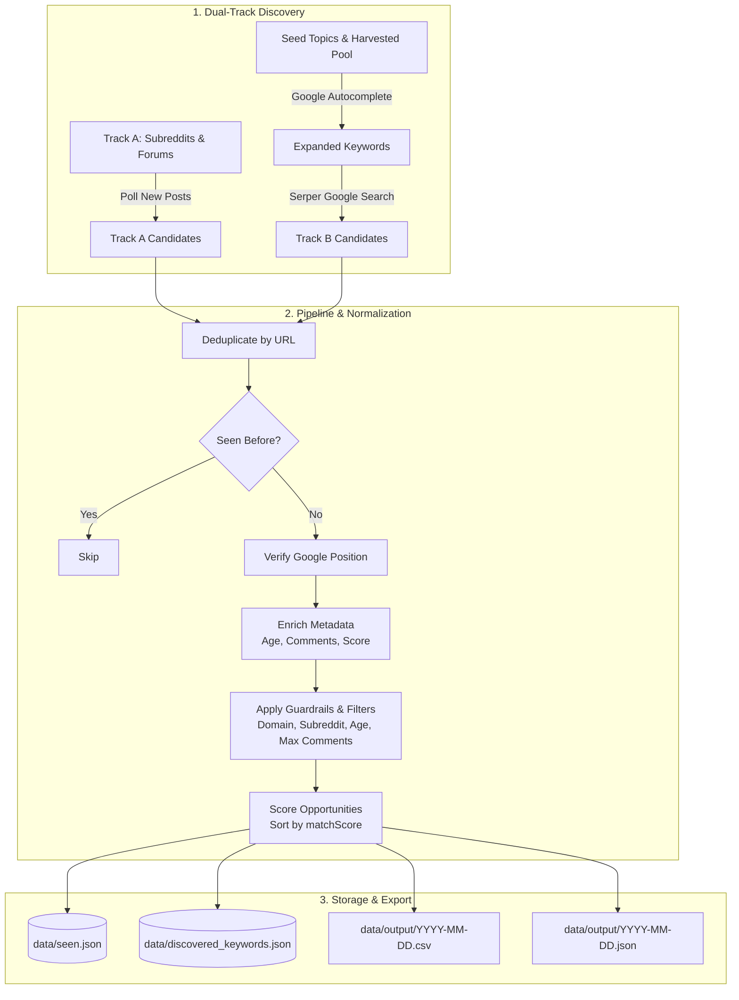

# 🎯 mention-finder

> Automated high-intent thread discovery engine that surfaces ranking community discussions across Reddit, Discourse, and WordPress forums for organic mention placement.

[](https://nodejs.org/)
[]()
[](https://serper.dev)
[]()

---

## 📖 Overview

**mention-finder** continuously monitors and discovers recent forum and social community threads (Reddit, Shopify Community, WordPress Support, Webflow Forums, Quora, etc.) that **already rank in Google's Top 5–10** for your target topics, are **fresh (3–45 days old)**, and have **low comment volume** — the highest-value opportunities to contribute helpful answers and mention your product or brand.

### Why This Exists
- **Instant Search Visibility:** Interacting with discussions that already rank on Google page 1 drives persistent, passive search traffic to your brand.
- **Organic & High-Intent:** Readers finding these threads via Google search have high purchase/solution intent.
- **Zero Database Overhead:** Operates cleanly with flat-file JSON/CSV persistence in `data/`. No external database, webhook, or cloud infrastructure needed.

---

## ⚡ Key Features

- 🔄 **Dual-Track Discovery Pipeline:**
  - **Track A (Community Monitoring):** Polls newest posts directly from allowlisted subreddits, Discourse forums, and RSS feeds, then verifies if they already rank in Google SERPs.
  - **Track B (Keyword Expansion & Search):** Automatically expands seed topics via Google Autocomplete + Serper.dev PAA (*People Also Ask*) & Related Searches (plus optional LLM brainstorming) to uncover ranking threads.
- 🧠 **Self-Growing Keyword Intelligence:** Harvests PAA questions and related queries from unfiltered topic queries into a local pool (`data/discovered_keywords.json`) to continuously expand coverage over time.
- 🎯 **Precise Scoping & Filtering:** Ensures results belong to allowlisted subreddits and approved domains, filtering out off-topic or aged threads.
- 🛡️ **Budget & Cost Protection:** Hard daily search call budget capping with local disk-based SERP response caching (24h TTL) to keep API expenses predictable (< $12/month).
- 📊 **Opportunity Scoring:** Calculates a deterministic `matchScore` favoring higher Google positions and lower comment counts for prioritized action.
- 📁 **Automated Daily Reporting:** Generates timestamped `.csv` and detailed `.json` exports in `data/output/`.

---

## 🏗️ Architecture & Pipeline Flow



---

## 🚀 Getting Started

### Prerequisites
- **Node.js**: `v18.x` or higher
- **Serper.dev API Key**: Required for Google SERP lookups and position verification ([Sign up here](https://serper.dev))
- **reddit-scraper-service** *(Optional but recommended)*: Sibling microservice for scraping Reddit metadata and monitoring Track A subreddits

### Installation

1. **Clone the repository:**
   ```bash
   git clone https://github.com/your-org/mention-finder.git
   cd mention-finder
   ```

2. **Install dependencies:**
   ```bash
   npm install
   ```

3. **Configure environment variables:**
   ```bash
   cp .env.example .env
   ```

4. **Edit `.env`:**
   ```ini
   SERPER_API_KEY=your_serper_api_key_here
   REDDIT_SCRAPER_SERVICE_URL=http://localhost:4100
   REDDIT_SCRAPER_SERVICE_API_KEY=
   ```

---

## 🕹️ Usage

### 1. Run Once (On-Demand Execution)
Executes a single end-to-end pipeline run and exits immediately upon completion:
```bash
npm run run:once
```

### 2. Scheduled Daemon (Continuous Cron)
Starts the long-running worker that executes on your configured cron schedule (default: `0 6 * * *` — 6:00 AM daily):
```bash
npm start
```

#### Production Deployment with PM2
```bash
npm install -g pm2
pm2 start src/index.js --name "mention-finder"
pm2 save
```

---

## ⚙️ Configuration Reference

### Environment Variables (`.env`)

| Variable | Type | Default | Description |
|---|---|---|---|
| `SERPER_API_KEY` | `string` | *None (Required)* | API key from [serper.dev](https://serper.dev) for Google search queries. |
| `REDDIT_SCRAPER_SERVICE_URL` | `string` | `http://localhost:4100` | Base URL of the sibling `reddit-scraper-service`. |
| `REDDIT_SCRAPER_SERVICE_API_KEY` | `string` | *Optional* | API key if authentication is enabled on the scraper service. |
| `SERP_DAILY_BUDGET` | `number` | `400` | Maximum daily Serper API requests allowed. Pipeline halts Serper calls once exhausted. |
| `EXPANSION_DEPTH` | `number` | `2` | Number of recursive Google Autocomplete expansion rounds. |
| `MAX_KEYWORDS_PER_DAY` | `number` | `500` | Hard upper cap on total expanded keywords queried per run. |
| `CACHE_TTL_HOURS` | `number` | `24` | Hours to cache raw SERP responses in `data/cache/`. |
| `MIN_POSITION` | `number` | `10` | Maximum Google SERP position to consider (e.g. `10` = top 10 results only). |
| `MIN_AGE_DAYS` | `number` | `3` | Minimum post age in days (avoids volatile 0-day threads). |
| `MAX_AGE_DAYS` | `number` | `45` | Maximum post age in days (ensures discussions are still active). |
| `MAX_COMMENTS` | `number` | `30` | Maximum comment count threshold (avoids overly saturated threads). |
| `ENABLE_LLM_BRAINSTORM` | `boolean` | `false` | Enable Claude/Anthropic brainstorm pass for long-tail queries. |
| `ANTHROPIC_API_KEY` | `string` | *Optional* | API key for Anthropic if `ENABLE_LLM_BRAINSTORM=true`. |
| `CRON_SCHEDULE` | `string` | `0 6 * * *` | Cron expression for scheduled execution (default: 6:00 AM daily). |

---

### Configuration Files (`config/`)

All target topics, domains, forums, and subreddits are configured through JSON files in [`config/`](file:///c:/projects/rankpilot/mention-finder/config):

| File | Description | Example Content |
|---|---|---|
| [`config/topics.json`](file:///c:/projects/rankpilot/mention-finder/config/topics.json) | High-level seed topics used for Track B expansion and PAA harvesting. | `["shopify seo", "rank shopify blog on google", "webflow seo blog"]` |
| [`config/subreddits.json`](file:///c:/projects/rankpilot/mention-finder/config/subreddits.json) | Allowlist of subreddits to monitor (Track A) and allow in search results (Track B). | `["shopify", "webflow", "Wordpress", "SEO", "ecommerce"]` |
| [`config/forums.json`](file:///c:/projects/rankpilot/mention-finder/config/forums.json) | Discourse forum categories and bbPress/WordPress RSS feeds to poll. | Discourse categories (Shopify Community) & bbPress RSS feeds. |
| [`config/domains.json`](file:///c:/projects/rankpilot/mention-finder/config/domains.json) | Allowlist of domains permitted across the pipeline. | `["reddit.com", "community.shopify.com", "wordpress.org/support", "forum.webflow.com", ...]` |
| [`config/verticals.json`](file:///c:/projects/rankpilot/mention-finder/config/verticals.json) | Industry niches used when `ENABLE_LLM_BRAINSTORM` is active. | `["ecommerce", "saas", "agency", "small business"]` |

---

## 🔬 How the Pipeline Works

### 1. Track A: Community Ingestion
- Ingests latest posts from configured subreddits (`subreddits.json`) via `reddit-scraper-service`.
- Polls Discourse categories (e.g. Shopify Community) and bbPress RSS feeds (e.g. WordPress Support).
- These posts start with no known Google ranking position (`position: null`).

### 2. Track B: Keyword Expansion & Search
- Combines seed `topics.json` with accumulated `data/discovered_keywords.json`.
- Runs Google Autocomplete expansion up to `EXPANSION_DEPTH` levels.
- Queries Serper with `gl=us` and `hl=en` and past-month filter (`tbs=qdr:m`).
- Performs an unfiltered PAA / Related Searches harvest per seed topic to replenish `discovered_keywords.json`.

### 3. Verification & Enrichment
- **Position Verification:** For Track A posts lacking a ranking position, searches Google for the post title to verify if the thread ranks in the top results (with exact URL match or fallback to same-domain/same-subreddit matching).
- **Metadata Enrichment:** Retrieves comment counts, post age, and engagement metrics via Reddit scraping and Discourse JSON endpoints (`/t/slug/id.json`).

### 4. Guardrail Filtering & Scoring
- Verifies post belongs to an allowlisted domain and allowlisted subreddit (preventing unrelated subreddits from leaking in).
- Enforces Google position $\le$ `MIN_POSITION`.
- Enforces age bounds (`MIN_AGE_DAYS` $\le$ age $\le$ `MAX_AGE_DAYS`) and comment threshold (`numComments` $<$ `MAX_COMMENTS`).
- Calculates opportunity match score:
  $$\text{matchScore} = (6 - \text{position}) \times 2 + \frac{30 - \text{comments}}{10}$$
- Higher rank in Google + fewer existing comments = **higher score**.

---

## 📂 Data Storage & Output Structure

All persistent state and output files reside in [`data/`](file:///c:/projects/rankpilot/mention-finder/data):

```
data/
├── seen.json                  # Map of processed URLs with timestamps (prevents duplicates)
├── discovered_keywords.json   # Auto-growing repository of discovered PAA/related queries
├── budget.json                # Daily Serper request counter (resets every 24h)
├── cache/                     # Cached SERP responses hashed by query & parameters (24h TTL)
│   └── *.json
└── output/                    # Generated daily reports
    ├── YYYY-MM-DD.csv         # Spreadsheet-ready daily opportunities
    └── YYYY-MM-DD.json        # Full structured payload
```

### Report Output Columns (`.csv`)

| Field | Description |
|---|---|
| `source` | Discovery origin (`trackA-reddit`, `trackA-discourse`, `trackA-bbpress`, or `serp`) |
| `keyword` | Keyword that surfaced the result (for Track B) |
| `title` | Title of the discussion thread or post |
| `url` | Direct URL to the discussion |
| `position` | Ranking position on Google SERP (1–10) |
| `ageDays` | Thread age in days |
| `numComments` | Total comment count |
| `matchScore` | Calculated priority score |

---

## 💰 Cost & SERP Budget Controls

Serper.dev costs roughly **~$1.00 per 1,000 queries**.
- With `SERP_DAILY_BUDGET=400`, the maximum possible monthly spend is **under $12/month**.
- The built-in query cache (`data/cache/`) prevents redundant queries within a 24-hour window.
- If daily budget is reached, the pipeline skips remaining SERP calls gracefully and processes all collected data without throwing unhandled exceptions.

---

## 🤝 Sibling Service: `reddit-scraper-service`

Due to Reddit's official API gating behind commercial approvals, `mention-finder` interfaces with Reddit via [`reddit-scraper-service`](../reddit-scraper-service) located in the sibling directory.

- Scrapes `old.reddit.com` public JSON endpoints through residential proxies with circuit-breaker protection and rate-limiting.
- **Graceful Degradation:** If `reddit-scraper-service` is offline or blocked, Track A Reddit polling and Track B Reddit comment enrichment will fail gracefully (logged without crashing). Track B Serper queries will continue discovering ranking Reddit threads.

---

## 🔌 Adding New Sources & Platforms

To add a new community or platform to Track A:
1. Create a platform adapter in `src/trackA/<platform>.js` implementing a collection function returning objects with `{ source, title, url, position: null }`.
2. Register the adapter in [`src/trackA/index.js`](file:///c:/projects/rankpilot/mention-finder/src/trackA/index.js).
3. If the platform has a public JSON or metadata API, add enrichment handling in [`src/enrich/index.js`](file:///c:/projects/rankpilot/mention-finder/src/enrich/index.js).
4. Add the platform domain to [`config/domains.json`](file:///c:/projects/rankpilot/mention-finder/config/domains.json).

---

## ⚠️ Known Considerations

- **Quora:** Included in `domains.json` for Track B SERP discovery, but has no direct Track A community polling due to aggressive anti-scraping protections.
- **YouTube & WordPress Support:** WordPress RSS feeds and YouTube results currently pass through without exact comment count enrichment (`ageDays` and `numComments` blank), bypassing strict comment filter thresholds.
- **Geotargeting:** All Serper and Autocomplete queries explicitly specify `gl=us` and `hl=en` to align ranking positions with US-based search results.

---

## 📄 License

Internal tool — All rights reserved.
# mention-finder

